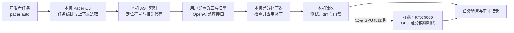

# Pacer

Pacer 是一个多模型编码 CLI：用户配置的 OpenAI 兼容云端模型负责生成代码，本机负责 AST 索引、应用补丁和验收。

## 架构



本机不运行大型语言模型。RTX 5060 仅用于 GPU 差分模糊测试验收。

## 五分钟上手

### 1. 安装

需要 Python 3.10 或更新版本；使用隔离工作树时还需要 Git。

```bash
git clone https://github.com/Xiaoyu155/pacer-recovery.git
cd pacer-recovery
python -m venv .venv
```

激活虚拟环境后安装：

```powershell
# Windows PowerShell
.venv\Scripts\Activate.ps1
python -m pip install -e .
pacer --version
```

```bash
# macOS / Linux
source .venv/bin/activate
python -m pip install -e .
pacer --version
```

### 2. 配置云端后端

在用户目录创建 `~/.pacer/model-gateway/providers.json`，把模型名替换成你的服务支持的模型：

```powershell
# Windows PowerShell
New-Item -ItemType Directory -Force "$HOME/.pacer/model-gateway" | Out-Null
notepad "$HOME/.pacer/model-gateway/providers.json"
```

```bash
# macOS / Linux
mkdir -p ~/.pacer/model-gateway
${EDITOR:-vi} ~/.pacer/model-gateway/providers.json
```

```json
{
  "tier3_premium": [
    {
      "name": "cloud-coder",
      "enabled": true,
      "provider": "openai",
      "model": "YOUR_MODEL",
      "base_url": "https://example.test/v1",
      "api_key_env": "PACER_API_KEY"
    }
  ]
}
```

由操作系统、终端或密钥管理器向 Pacer 进程注入 `PACER_API_KEY`；不要把密钥写入 JSON 文件或仓库。让编码任务使用这个云端后端：

```powershell
# Windows PowerShell
$env:PACER_CODER_CASCADE = "premium_api"
```

```bash
# macOS / Linux
export PACER_CODER_CASCADE=premium_api
```

检查配置状态：

```console
pacer backends
```

### 3. 跑第一个任务

进入要修改的 Git 项目根目录，替换示例中的模块名、问题描述和测试路径：

```console
pacer auto "修复 src/YOUR_MODULE.py 中的问题，并补充回归测试" --worktree --verify-cmd "python -m pytest tests/test_YOUR_MODULE.py -q"
```

`--worktree` 会从当前提交建立隔离分支；通过验收后，Pacer 会在该分支创建提交，但不会自动合并。当前工作区里未提交的改动不会复制到隔离工作树。省略此选项则在当前工作区执行。

## 命令列表

| 命令 | 用途 |
| --- | --- |
| `pacer auto "<任务>"` | 编排任务、生成并应用补丁、运行验收；可加 `--worktree`、`--verify-cmd`、`--dry-run`、`--fast-local` |
| `pacer plan "<任务>"` | 预览子任务拆分，不执行修改 |
| `pacer verify` | 检查当前改动；可用 `--cmd "<测试命令>"` 指定验收命令 |
| `pacer backends` | 查看配置的模型和本地后端状态 |
| `pacer trace --limit 10` | 查看最近的执行记录 |
| `pacer dashboard` | 启动本机 Dashboard |
| `pacer host --workspace-root <目录> --steps <数量>` | 继续未完成的计划 |
| `pacer embed [目录]` | 为目标目录配置 Pacer 与 Claude Code / VS Code 的集成 |
| `pacer mcp` | 启动 MCP 标准输入输出服务 |
| `pacer grok "<提示>"`、`pacer gemini "<提示>"`、`pacer wb "<提示>"` | 调用对应的模型或桌面网关 |
| `pacer gateway` | 启动 Pacer 网关服务 |
| `pacer completion --output-dir <目录>` | 生成 Bash、Zsh 和 PowerShell 补全脚本 |
| `pacer --help`、`pacer --version` | 查看帮助或版本 |

## FAQ

### Pacer 会在本机运行大模型吗？

不会。代码生成交给你配置的云端模型；本机执行代码索引、补丁应用和验收。RTX 5060 只用于 GPU 差分模糊测试。

### `pacer backends` 显示可用，就代表模型生成一定成功吗？

不代表。状态检查能报告配置和连接线索，但不能替代真实生成请求；服务鉴权、模型权限和上游限额仍可能导致任务失败。

### API 密钥应该放在哪里？

把密钥作为环境变量 `PACER_API_KEY` 注入 Pacer 进程。配置文件只保存 `api_key_env` 这样的变量名，不要把密钥提交到 Git。

### `--worktree` 会把结果合并进当前分支吗？

不会。验收通过后，改动提交在隔离分支中；检查差异后再自行合并。它要求项目已有 Git 仓库和提交过的 `HEAD`。

### 如何指定项目自己的测试命令？

在 `pacer auto` 中加 `--verify-cmd "<测试命令>"`，或在之后运行 `pacer verify --cmd "<测试命令>"`。

### OpenAI 兼容服务使用什么地址？

示例中的 `base_url` 是服务的 API 根地址，使用 `https://example.test/v1` 作为占位值。将它替换为你自己的服务地址；OpenAI 兼容后端默认使用 Chat Completions 接口。

## 许可证

Pacer 使用 [MIT 许可证](LICENSE)。
