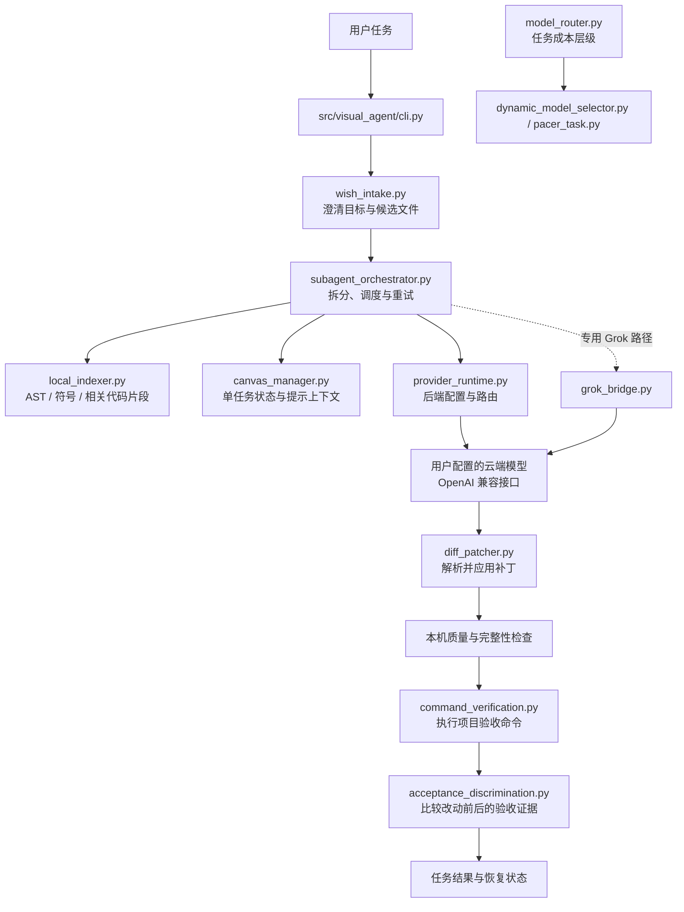

# Pacer 源码总览

本文说明当前 Pacer 编码 CLI 的源码结构。`src/visual_agent` 是保留的 Python 导入路径；包说明已明确，旧视觉自动化 SDK 不再包含在当前产品中。

## 产品入口

Pacer 把任务交给用户配置的云端模型生成补丁，由本机完成目标文件索引、补丁应用和验收。RTX 5060 只用于 GPU 差分模糊测试，不用于本地大模型推理。

项目元数据位于仓库根目录 `pyproject.toml`：

- Python distribution：`visual-agent`
- Python 导入包：`visual_agent`
- CLI 入口：`visual_agent.cli:main`
- 命令别名：`pacer`、`checkpoint`、`visual-agent`
- 最低 Python 版本：3.10

主要目录：

| 路径 | 用途 |
| --- | --- |
| `src/visual_agent/` | CLI、任务编排、模型适配、补丁和验收实现 |
| `tests/` | 单元、集成与回归测试 |
| `docs/` | 产品和开发文档 |
| `examples/` | 示例和试验性代码 |
| `scripts/` | 维护及开发脚本 |

## 运行链路

图中把相互配合的模块画成一条概念链路；具体门禁是否启用以及执行顺序取决于任务计划和路由策略。`anti_slop.py`、`tamper_guard.py` 与 `witness_verifier.py` 参与本机质量或验收检查。

## 核心模块

| 模块 | 当前职责 |
| --- | --- |
| `wish_intake.py` | 将用户的一句话与项目画像整理成可执行目标；识别模糊请求、引用的规格文件、目标文件候选和续跑意图。信息不足时返回一个澄清问题，不把聊天记录整体带入任务。 |
| `subagent_orchestrator.py` | 定义 `SubagentPlan` / `SubagentTask`，拆分任务、构建依赖波次并运行 worker；准备上下文、调用后端、应用补丁、运行验收、处理重试与检查点。规划可走本地规则或模型路径。 |
| `canvas_manager.py` | 管理工作区 `.pacer/canvas.json`，保存目标、验收命令、约束、焦点文件和最近失败信息；用锁和原子替换维护状态，并按预算组装单轮提示。默认提示预算为估算值，不代表模型 tokenizer 的实测 token 数。 |
| `diff_patcher.py` | 解析 `SEARCH/REPLACE` 补丁块，校验目标路径位于工作区且符合任务允许文件范围，再以精确、忽略行尾空白或缩进容差方式匹配并应用；返回逐操作结果。 |
| `anti_slop.py` | 对变更的 Python 源码做 AST 检查，识别空测试、恒真断言、吞掉异常和空洞实现等模式，并生成供修复轮次使用的诊断。不是通用的多语言静态分析器。 |
| `tamper_guard.py` | 冻结验收测试和配置基线，检查受保护文件哈希、pytest 收集 ID 及新增测试逃逸调用；在补丁落盘前拒绝受保护输入的改动，并在运行期间检测或恢复受保护文件。是否启用由编排策略决定。 |
| `acceptance_discrimination.py` | 在基线副本和当前工作区运行同一验收命令，区分 `verified`（基线失败、当前通过）、`regression_clear`（基线已通过或无法证明目标差异）和 `unverified`（缺少有效验收证据）。 |
| `witness_verifier.py` | 提供测试断言实质性检查、语法变异敏感性检查、执行跟踪辅助函数和 `WitnessCertificate` 数据结构。编排器的常规路径会检查被修改的 Python 测试断言；完整 witness 流程不是每个任务都会执行。 |
| `command_verification.py` | 将验收命令解析并按安全策略校验后，以参数列表运行；处理超时、进程保护、验收输入前后快照、失败分类和输出脱敏。 |
| `local_indexer.py` | 对 Python 使用原生 AST 提取导入、符号、签名和行范围；对其他受支持源码或无法解析的 Python 提供正则回退，并从 traceback 定位文件和行号、提取聚焦代码窗口。 |
| `model_router.py` | 根据目标描述、文件范围、验收条件和重试情况，将任务分类为 `cheap`、`standard` 或 `strong`。它给出任务成本层级，不负责解析 API 地址或检查后端可用性。 |
| `provider_runtime.py` | 读取 provider 池配置，解析模型节点、启用状态、可用性和冷却时间，并生成路由候选。状态显示“已配置”或“可连接”不等于已验证模型生成。 |
| `grok_bridge.py` | Grok 专用的 OpenAI 兼容流式适配器，支持直接 Grok 调用及兼容网关配置；它与通用 provider 池是独立入口。 |

## 配置与状态

通用 provider 配置默认位于用户目录下的 `~/.pacer/model-gateway/providers.json`；可用 `PACER_PROVIDERS_FILE` 指定其他文件。节点包含 provider、model、base URL 和 `api_key_env` 等字段，密钥由该字段引用的环境变量提供，不应把密钥值提交到仓库。

`PACER_CODER_CASCADE` 用于指定编码后端路由顺序，例如选择 `premium_api`。该路由名表示后端类别，不是具体模型名。provider 配置由 `provider_runtime.py` 解析，实际 OpenAI 兼容请求经 `llm_providers.py` 发送。

专用 Grok 入口读取 `PACER_GROK_API_BASE`、`PACER_GROK_API_KEY` 和 `PACER_GROK_MODEL` 等环境变量，也兼容本地凭据文件。不要把本机凭据文件复制进示例配置或提交到 Git。

## CLI 与测试

CLI 的 argparse 子命令在 `src/visual_agent/cli.py` 注册。当前主要入口包括：

- `pacer auto`：规划并执行任务
- `pacer plan`：预览任务拆分
- `pacer verify`：运行验收与交付检查
- `pacer host`：继续未完成的计划
- `pacer backends`：查看后端状态
- `pacer trace`、`pacer dashboard`：查看执行记录和本机状态
- `pacer embed`、`pacer mcp`：配置编辑器集成和启动 MCP 服务
- `pacer grok`、`pacer gemini`、`pacer wb`：调用专用后端入口
- `pacer gateway`：启动 Pacer 网关服务
- `pacer completion`：生成 shell 补全脚本

相关回归覆盖分布在 `tests/`，例如 `test_wish_intake.py`、`test_subagent_orchestrator.py`、`test_canvas_manager.py`、`test_diff_patcher.py`、`test_anti_slop.py`、`test_tamper_guard.py`、`test_acceptance_discrimination.py`、`test_witness_verifier.py`、`test_model_router.py` 和 `test_provider_runtime.py`。

## 重要边界

- `model_router.py` 决定任务成本层级；`provider_runtime.py` 决定哪些后端节点可用以及如何路由。两者不是同一层的模型选择。
- `pacer backends` 的状态是配置或连接线索，不是一次生成请求的端到端证明。
- 验收命令通过只说明该命令返回成功。只有基线探针显示同一命令在改动前失败、当前通过时，`acceptance_discrimination.py` 才能标记为 `verified`。
- `witness_verifier.py` 中的 `trace_execution()` 是独立辅助函数；编排器常规路径不代表每次都会采集运行跟踪或执行变异测试。当前 `certify_delivery()` 成功分支没有调用该辅助函数，却将执行跟踪字段填为通过；这些字段不代表独立采集的运行跟踪证据。
- 本机不运行大型语言模型；RTX 5060 的用途限于 GPU 差分模糊测试验收。
